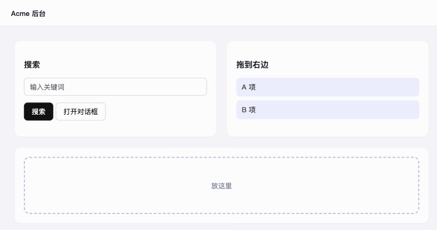

<div align="center">



<p>
  <a href="https://github.com/OrderG-X/dsh-chrome-bridge/releases"></a>
  
  <a href="https://chromewebstore.google.com/detail/bippcbbbipppmhjkjomgdnjbooecbimo"></a>
  = 116" />
  
  = 18" />
  
</p>

<p>
  <a href="README.md"><b>English</b></a> ·
  <a href="README.zh.md">简体中文</a> ·
  <a href="docs/NOTES.zh.md">Development notes</a>
</p>

</div>

---

**Give your DSH agent hands inside the Chrome you are already using** — your logins, your tabs, your session. Install once, no Connect button, ever.

> **What it is:** a DeepSeek Harness (DSH) plugin that lets the model operate the Chrome you already use: open pages, click, type, fill in forms, read pages, take screenshots and work across tabs, with your existing logins.
>
> **Use it for:** "fill in this web form", "check this admin page for me", "screenshot this site", or anything else the model has to do inside a browser.
>
> **Install:** `dsh plugin add https://github.com/OrderG-X/dsh-chrome-bridge/releases/latest/download/dsh-chrome-bridge.tgz`, restart DSH, then add the DSH Bridge extension from the [Chrome Web Store](https://chromewebstore.google.com/detail/bippcbbbipppmhjkjomgdnjbooecbimo). Needs macOS, Windows or Linux, Chrome 116+ and Node.js 18+.



<sub>Every click flies a cursor to the target and labels what it is doing. It renders *inside the page*, so it lands in screenshots too — you and the model look at the same picture.</sub>

## ✨ Why another browser bridge?

Every existing option makes you click something, every time:

| Option | What goes wrong |
|---|---|
| `chrome-devtools-mcp --autoConnect` | Chrome asks *"Allow remote debugging?"* on **every** connection |
| Browser MCP (store extension) | You must click the extension icon → **Connect** on **every** tab |
| WebSocket-based bridges | Open a TCP port and trust anything that can reach it |
| **dsh-chrome-bridge** | Nothing to click. Nothing listening on a port. |

Three things make the difference:

- 🔌 **Native messaging, not a port.** The extension talks to a local Node host over Chrome's native messaging pipe; the CLI reaches the host through a `0600` Unix socket guarded by a token. No TCP port to scan, no origin to spoof.
- 🎯 **`chrome.debugger`, not injected scripts.** Clicks and keystrokes are dispatched as real CDP `Input.*` events, so they carry a user gesture — popups open, focus works, and sites that reject synthetic events behave normally. Screenshots, network, console and raw CDP come for free.
- 👀 **A cursor the human can see.** A translucent light-blue arrow with a "🌐 DSH" name tag glides along a gentle arc to the target; the tag says what it is doing (click / type / drag / scroll) and each click leaves a soft ripple. It shares one style with the desktop cursor of [dsh-mac-computer-use](https://github.com/OrderG-X/dsh-mac-computer-use) (solid there, with a monitor icon), so you can tell at a glance whether the work is in the browser or on the desktop. It sits above modals and fullscreen, and picks up where it was after a navigation. Because it is rendered inside the page, **it appears in screenshots**.

## 🏗 Architecture

```
DSH's agent  (provided by the harness — this repo ships none)
  ├── browser_* tools  (DSH plugin)  ─┐
  └── cb CLI           (shell)       ─┤
                                      ▼
                     Unix socket  /tmp/dsh-bridge-<uid>/   (0700 dir + token)
                                      ▼
                     Node native host  ←─ native messaging (stdio) ─→  Chrome extension (MV3)
                                                                            │ chrome.debugger
                                                                            ▼
                                                                       real CDP
```

**This repo ships no agent** — the agent above is DSH's own; we only give it hands.

The extension ID is fixed by the public key embedded in `plugin/vendor/extension/manifest.json`, so it is **identical on every machine** and the native-host registration never needs editing. The Web Store build has its own store-assigned ID; the host accepts both.

## 🚀 Install

**The host ships inside the plugin package.** Adding the plugin copies the native host and the MV3 extension into place and registers native messaging for you — no `git clone`, no `install.sh`, no `python3`.

Requirements: **macOS, Windows or Linux**, **Google Chrome 116+**, **Node.js 18+**.

**1.** Sidebar → **Plugins** → **Add plugin** → paste this → Install → Enable → **restart DSH**:

```
https://github.com/OrderG-X/dsh-chrome-bridge/releases/latest/download/dsh-chrome-bridge.tgz
```

**2.** The plugin installs the host on first load (`~/.dsh/chrome-bridge`, `~/dsh-bridge-extension`, plus `com.dsh.bridge.json` in Chrome's `NativeMessagingHosts`). All that's left is getting the extension into Chrome — pick one:

**Recommended: install from the Chrome Web Store** — open the [DSH Bridge store page](https://chromewebstore.google.com/detail/bippcbbbipppmhjkjomgdnjbooecbimo) → **Add to Chrome**. No Developer mode, and the extension updates itself.

**Or: load it unpacked** (to run the newest extension from the repo). Chrome 137+ removed `--load-extension`, so that click has to be yours; the plugin walks you to it:

- the first time a `browser_*` tool finds nothing to talk to, it **opens `chrome://extensions` in a background tab** and **puts `~/dsh-bridge-extension` on your clipboard** (once per session; the error text repeats the steps);
- in the file picker press **⌘⇧G**, then **⌘V**, then Enter — no folder hunting (Windows: paste into the picker's address bar, then Enter; Linux: **Ctrl+L**, paste, Enter).

Do it once, ever:

1. open `chrome://extensions`
2. enable **Developer mode** (top right)
3. **Load unpacked** → **⌘⇧G** → **⌘V** → Enter (the folder is already on your clipboard; Windows / Linux: see above)

From a source checkout, `./bridge setup` does exactly this in one command: installs the host, opens the page, copies the path, and waits until the extension connects — printing ✅ when it does.

**3.** Verify (the `cb` CLI is installed along the way):

```bash
cb status     # host pid … | extension connected: ✅
cb tabs
```

Until step 2 is done the `browser_*` tools fail **loudly with exactly these steps** — never silently.

### 🧩 The twelve native tools

| Tool | What it does |
|---|---|
| `browser_tabs` | list / find / open / close / activate tabs |
| `browser_read` | **numbered list of clickable / fillable elements** (`snapshot` — **same-origin iframes included, and their elements are clickable by number too**), visible text, HTML, attributes, page info |
| `browser_click` | click by element number (`ref`), selector, text, or coordinates |
| `browser_input` | type, press keys, select, upload, hover, scroll |
| `browser_nav` | go to a URL, **back / forward / reload**, and wait for load |
| `browser_screenshot` | screenshot **returned as an image** (viewport / full / element) |
| `browser_eval` | run JS in the page |
| `browser_wait` | wait for an element, **a piece of text, or a URL** — or for it to go away (`gone`) |
| `browser_dialog` | release alert / confirm / prompt |
| `browser_drag` | drag by element number, selector, **visible text** or coordinates — HTML5 drag-and-drop and mouse-driven widgets (sliders, sortable lists) |
| `browser_download` | **download a file** (invoices, reports, PDFs…) with your Chrome login, into Downloads or the session's working directory; never overwrites |
| `browser_devtools` | **console output + uncaught JS errors, network requests (status, timing), a request's response body** |

> A freshly installed bundle is not hot-loaded; DSH must be restarted once.
> `dsh plugin add` from the CLI refuses the app-managed profile — use the sidebar there.
> Plugin updates are not automatic in DSH yet: to upgrade, uninstall and install again.

### 👀 What you see while it works

- **Click the toolbar icon** for a live panel: whether Chrome ↔ local host ↔ DSH are connected, **which DSH sessions are driving which tabs** (jump to a tab, or release it with one click), the last actions with their errors, a **pause switch** that makes the browser off-limits until you turn it back on, and *copy diagnostics* for bug reports. The icon badge shows how many tabs are under control (`!` = host down, `⏸` = paused).
- **In DSH, Plugins → Chrome Bridge** has a settings card too: connection status, whether the extension is the local or the Web Store build, which tabs are under control (release them all with one click), plus pause and on-page-cursor switches. When it isn't connected it tells you the missing step and can open the install page for you. **Resuming control only works from the Chrome extension panel** — the model can reach the DSH side as well, so that click has to be yours.
- **The agent never falls back to the tab you are looking at.** A `browser_*` call without `tab` keeps using the tab that session opened or last named; if there is none it fails and says so. Acting on your current tab takes an explicit `tab="active"`.
- Every tab the agent touches **joins a blue tab group titled "DSH agent 正在操作"** (pinned tabs and tabs already in one of your groups are left where they are), and the group is taken apart the moment it lets go — after 60s idle, on `cb detach`, if the tab is closed, or if you press *Cancel* on Chrome's debugging banner.
- The little mouse (favicon + toolbar icon) means **there is actually a cursor in that page**: it lights up when the agent draws its on-page cursor (clicking, typing), and goes away when that cursor is hidden, the page navigates, or the agent lets go. Reading a page never lights it up.
- Inside the page, the on-page cursor draws every click, keystroke, drag and scroll — and it appears in screenshots, so you and the model see the same picture. If it gets in your way, switch it off in the panel (the actions still happen, it just isn't drawn). Password fields only ever show dots.

### 🛠 From source (development)

```bash
git clone https://github.com/OrderG-X/dsh-chrome-bridge.git
cd dsh-chrome-bridge
./install.sh        # same layout as the plugin's auto-install, plus the manager CLI
./bridge status     # repo / installed / running version + connection
```

Then point DSH at the checkout for the native tools: **Plugins → Add plugin** → `/absolute/path/to/dsh-chrome-bridge/plugin` (a `link:`, so a `git pull` is enough to update).

## 📖 Usage

### `cb` — from the shell

```bash
cb status / cb version / cb reload      # health, hot-reload the extension after edits

cb tabs                                 # list tabs (* = active)
cb find <keyword>                       # filter by title/URL
cb info   active                        # title, URL, viewport, pending dialog

cb text   active [selector]             # visible text (best first read)
cb html   active [selector]
cb attr   active <selector> <name>
cb wait-for active "<selector>"         # wait until it exists and is visible

cb eval   active "<js>"                 # run JS in the page
cb click-el   active "<selector>"       # real mouse event
cb click-text active "Sign in"
cb click  active <x> <y>
cb type   active "text" --into "<selector>"
cb key    active Enter                  # combos: "meta+a"
cb focus / cb select / cb upload / cb hover / cb scroll
cb dialog active accept                 # release an alert/confirm — otherwise the page hangs

cb nav    active https://example.com
cb shot   active --out /tmp/x.png       # --full whole page, --sel "<selector>" one element
cb console active / cb network active --reload
cb cursor active click 400 300          # drive the cursor by hand
cb cdp    active Page.reload '{}'       # raw CDP escape hatch
```

`active` can be replaced by a tab id. Add `--json` for raw output.
Clicks and typing move the visible cursor by default; pass `--no-cursor` to skip it.

### Management

```bash
dsh-chrome-bridge status      # repo / installed / running version + connection
dsh-chrome-bridge update      # sync code + hot-reload the extension (no Chrome clicking)
dsh-chrome-bridge test        # end-to-end self test
dsh-chrome-bridge logs        # extension log + host log
dsh-chrome-bridge uninstall
```

## 🔒 Security

Be honest about what this is: **the extension can read and control every page you are logged into.**

- The bridge is **local-only**. Native messaging is a private pipe; the CLI socket is `0600` and additionally token-guarded. **It opens no network listener of its own** (the DSH settings card goes through DSH's built-in local web server; that route only accepts loopback, rejects cross-site requests, and cannot resume control).
- Chrome shows a permanent *"… is debugging this browser"* banner while attached. That banner is the point — you can always see that it is active.
- Anything that can already run as your user can read your Chrome profile; this does not widen that boundary. It does make it *convenient*, which is worth a thought before leaving an agent unattended.
- **Once the DSH plugin is installed, the model drives your browser without asking.** Plugin tools run inside the DSH host process, so they are *not* gated by the workspace sandbox or the approval prompts that guard `bash`. That is what "native" buys you — and it means an unattended agent holds your browser. Disable the plugin in the sidebar if you want that gate back.
- Detach any time: click **Cancel** on the banner, or `cb detach <tab>`.

## ⚠️ Limitations

- **Windows and Linux support is new** — a daily CI run on GitHub's Windows and Linux machines installs it, connects a real Chrome and reads a page, but it has not been used on a real person's PC yet. Please open an issue if something breaks. On Windows it also registers for Edge (untested).
- **`chrome://` pages are unreachable** — Chrome forbids injection there. Use a normal tab.
- An `alert()` blocks the page: `cb info` warns you, `cb dialog accept` releases it.
- Chrome defers `alert()` in background tabs until the tab is focused.
- Without the Web Store, Chrome 137+ (no more `--load-extension`) needs one manual load through `chrome://extensions`.
- The Web Store build lags the repo a little: new extension versions wait for store review.

## 🔎 Related projects

The DSH browser-plugin space is already busy — these are worth a look:

- [dsh-plugin-browser-use](https://github.com/fatmind/dsh-plugin-browser-use) — reuses your logged-in Chrome, exposes `wc3_*` tools
- [dsh-plugin-browser](https://github.com/menotbobbybrown/dsh-plugin-browser) — Playwright-based browser automation plugin
- [dsh-browser-bridge](https://github.com/liyongzheng666/dsh-browser-bridge) — localhost WebSocket bridge with a Firefox extension
- [awesome-dsh-plugin](https://github.com/awesome-dsh-plugin/awesome-dsh-plugin) — the curated catalog of DSH plugins

What is different here: **no listening port** (native messaging), **real CDP input events** via `chrome.debugger`, and an **on-page cursor that shows up in screenshots**.

## 💬 Feedback

Found a bug or want a feature? [Open an issue](https://github.com/OrderG-X/dsh-chrome-bridge/issues/new/choose). Including your DSH and plugin versions helps a lot.

## 🤝 Contributing

Issues and PRs welcome.

`docs/NOTES.zh.md` is the running log of every pitfall hit while building this — read it before changing the extension or the plugin; it will save you a day. It also documents a way to **verify the plugin without restarting your app** (throwaway profile + headless).

MIT licensed.
